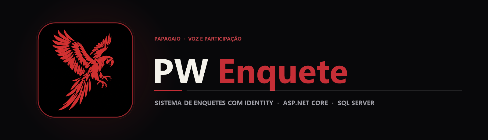

  

  Plataforma web de enquetes com controle de acesso por perfil (Admin e Usuário), ASP.NET Core Identity, Entity Framework Core e SQL Server.

  
  
  

## Sobre o projeto

O **ProjetoPWEnquete** é uma aplicação web completa em **C# e ASP.NET Core MVC (.NET 9)** que expande o conceito de um sistema de votações ao incorporar persistência relacional robusta em **SQL Server** e separação de permissões entre administradores e participantes.

O sistema conta com controladores especializados para autenticação (AccountController), administração de enquetes (AdminEnquete), participação do usuário (UserEnquetesController) e exibição geral (EnqueteController), apoiados por um histórico detalhado de migrações do **Entity Framework Core**.

## Principais recursos

| Recurso | Como funciona |
|---|---|
| Painel Administrativo (AdminEnquete) | Criação, edição, ativação e encerramento de enquetes com acompanhamento de votos. |
| Área do Participante (UserEnquetesController) | Fluxo dedicado para visualização de enquetes disponíveis e registro seguro do voto. |
| Autenticação e Perfis (AccountController) | Gerenciamento de contas e sessões integrado ao banco de dados via Identity / EF Core. |
| Persistência SQL Server (AppDbContext) | Mapeamento relacional completo com mais de 10 migrações incrementais documentando a evolução do schema. |

## Tecnologias

  
  
  
  
  

## Arquitetura

`mermaid
flowchart LR
    A[Usuário / Administrador] --> B[AccountController · Autenticação]
    B --> C[AdminEnquete · Gestão]
    B --> D[UserEnquetesController · Votação]
    C --> E[AppDbContext · EF Core]
    D --> E
    E --> F[(SQL Server)]
`

## Estrutura do repositório

`	ext
ProjetoPWEnquete/
├── assets/
│   ├── banner.png                          Banner principal PW Enquete
│   └── project-animal.png                  Símbolo do papagaio
├── ProjetoPWEnquete/
│   ├── Controllers/                        Account, AdminEnquete, Enquete, Home e UserEnquetes
│   ├── Data/AppDbContext.cs                Contexto relacional do Entity Framework Core
│   ├── Migrations/                         Histórico evolutivo do schema SQL Server
│   ├── Models/ & Views/                    Entidades de domínio e telas Razor (.cshtml)
│   └── Program.cs                          Configuração de autenticação, EF Core e rotas
├── ProjetoPWEnquete.sln                    Solução Visual Studio
└── README.md
`

## Executando o código

1. Clone o repositório:
   `powershell
   git clone https://github.com/arthurlynow098/ProjetoPWEnquete.git
   cd ProjetoPWEnquete
   `
2. Configure sua string de conexão do **SQL Server** em ProjetoPWEnquete/appsettings.json.
3. Aplique as migrações e inicie a aplicação:
   `powershell
   dotnet ef database update --project ProjetoPWEnquete
   dotnet run --project ProjetoPWEnquete/ProjetoPWEnquete.csproj
   `

---

Estudo · construção · evolução <a href="https://github.com/arthurlynow098">Perfil</a> · <a href="https://arthurentsev.vercel.app/">Portfólio</a> · <a href="https://www.linkedin.com/in/entsevarthur/">LinkedIn</a>

