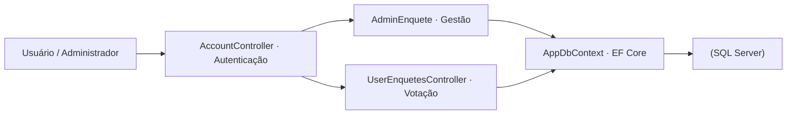

<p align="center">
  
</p>

<p align="center">Plataforma de enquetes com autenticação, perfis de acesso e persistência em SQL Server.</p>

<p align="center">
  
  
  
</p>

<p align="center"><a href="#visão-geral">Visão geral</a> &nbsp;·&nbsp; <a href="#recursos">Recursos</a> &nbsp;·&nbsp; <a href="#como-executar">Como executar</a></p>

---

## Visão geral

O sistema conta com controladores especializados para autenticação (AccountController), administração de enquetes (AdminEnquete), participação do usuário (UserEnquetesController) e exibição geral (EnqueteController), apoiados por um histórico detalhado de migrações do **Entity Framework Core**.

## Recursos

| Recurso | Como funciona |
|---|---|
| Painel Administrativo (AdminEnquete) | Criação, edição, ativação e encerramento de enquetes com acompanhamento de votos. |
| Área do Participante (UserEnquetesController) | Fluxo dedicado para visualização de enquetes disponíveis e registro seguro do voto. |
| Autenticação e Perfis (AccountController) | Gerenciamento de contas e sessões integrado ao banco de dados via Identity / EF Core. |
| Persistência SQL Server (AppDbContext) | Mapeamento relacional completo com mais de 10 migrações incrementais documentando a evolução do schema. |

<details>
<summary>Arquitetura</summary>



</details>

<details>
<summary>Estrutura do repositório</summary>

```text
ProjetoPWEnquete/
├── assets/
│   └── project-animal.png          Emblema do projeto
├── ProjetoPWEnquete/
│   ├── Controllers/                        Account, AdminEnquete, Enquete, Home e UserEnquetes
│   ├── Data/AppDbContext.cs                Contexto relacional do Entity Framework Core
│   ├── Migrations/                         Histórico evolutivo do schema SQL Server
│   ├── Models/ & Views/                    Entidades de domínio e telas Razor (.cshtml)
│   └── Program.cs                          Configuração de autenticação, EF Core e rotas
├── ProjetoPWEnquete.sln                    Solução Visual Studio
└── README.md
```

</details>

## Como executar

1. Clone o repositório:
   ```powershell
   git clone https://github.com/arthurlynow098/ProjetoPWEnquete.git
   cd ProjetoPWEnquete
   ```
2. Configure sua string de conexão do **SQL Server** em ProjetoPWEnquete/appsettings.json.
3. Aplique as migrações e inicie a aplicação:
   ```powershell
   dotnet ef database update --project ProjetoPWEnquete
   dotnet run --project ProjetoPWEnquete/ProjetoPWEnquete.csproj
   ```

---

<p align="center">
  <a href="https://github.com/arthurlynow098">GitHub</a> &nbsp;·&nbsp;
  <a href="https://arthurentsev.vercel.app/">Portfólio</a> &nbsp;·&nbsp;
  <a href="https://www.linkedin.com/in/entsevarthur/">LinkedIn</a>
</p>
