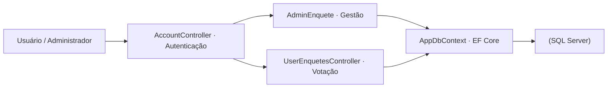

<a id="top"></a>

<p align="center"><sub>Projeto Enquete</sub></p>

---

<p align="center"></p>

<p align="center">Plataforma de enquetes com autenticação, perfis de acesso e persistência em SQL Server.</p>

<p align="center">


</p>

<p align="center"><a href="#visão-geral">Visão geral</a> &nbsp;·&nbsp; <a href="#recursos">Recursos</a> &nbsp;·&nbsp; <a href="#como-executar">Como executar</a></p>

<a id="explore-o-projeto"></a>

<a id="por-onde-começar"></a>

## Por onde começar

- **[Enquetes](ProjetoPWEnquete/Controllers/EnqueteController.cs)**, ações relacionadas às enquetes.
- **[Banco de dados](ProjetoPWEnquete/Data/AppDbContext.cs)**, contexto de persistência da aplicação.
- **[Conta](ProjetoPWEnquete/Controllers/AccountController.cs)**, ações relacionadas ao acesso dos usuários.

<a id="visão-geral"></a>

<a id="sobre-o-projeto"></a>

## Sobre o projeto

O sistema conta com controladores especializados para autenticação (AccountController), administração de enquetes (AdminEnquete), participação do usuário (UserEnquetesController) e exibição geral (EnqueteController), apoiados por um histórico detalhado de migrações do **Entity Framework Core**.

<a id="recursos"></a>

## Recursos

**Painel Administrativo (AdminEnquete)**<br>
Criação, edição, ativação e encerramento de enquetes com acompanhamento de votos.

**Área do Participante (UserEnquetesController)**<br>
Fluxo dedicado para visualização de enquetes disponíveis e registro seguro do voto.

**Autenticação e Perfis (AccountController)**<br>
Gerenciamento de contas e sessões integrado ao banco de dados via Identity / EF Core.

**Persistência SQL Server (AppDbContext)**<br>
Mapeamento relacional completo com mais de 10 migrações incrementais documentando a evolução do schema.

<a id="arquitetura"></a>

## Arquitetura



<a id="estrutura-do-repositório"></a>

## Estrutura do repositório

```text
ProjetoPWEnquete/
├── assets/
│   └── identity/banner.png               Banner do projeto
├── ProjetoPWEnquete/
│   ├── Controllers/                        Account, AdminEnquete, Enquete, Home e UserEnquetes
│   ├── Data/AppDbContext.cs                Contexto relacional do Entity Framework Core
│   ├── Migrations/                         Histórico evolutivo do schema SQL Server
│   ├── Models/ & Views/                    Entidades de domínio e telas Razor (.cshtml)
│   └── Program.cs                          Configuração de autenticação, EF Core e rotas
├── ProjetoPWEnquete.sln                    Solução Visual Studio
└── README.md
```

<a id="como-executar"></a>

## Como executar

1. Clone o repositório
   ```powershell
   git clone https://github.com/arthurlynow098/ProjetoPWEnquete.git
   cd ProjetoPWEnquete
   ```
2. Configure sua string de conexão do **SQL Server** em ProjetoPWEnquete/appsettings.json.
3. Aplique as migrações e inicie a aplicação
   ```powershell
   dotnet ef database update --project ProjetoPWEnquete
   dotnet run --project ProjetoPWEnquete/ProjetoPWEnquete.csproj
   ```

<p align="center">
  <a href="https://github.com/arthurlynow098">GitHub</a> &nbsp;·&nbsp;
  <a href="https://arthurentsev.vercel.app/">Portfólio</a> &nbsp;·&nbsp;
  <a href="https://www.linkedin.com/in/entsevarthur/">LinkedIn</a>
</p>

<a id="identidade-e-créditos"></a>

## Identidade e créditos

<table><tr><td width="150"></td><td><strong>Suricato</strong><br>Atenção coletiva e participação em grupo.<br><br><a href="assets/identity-v2/logo.png">Logo em PNG</a> · <a href="assets/identity-v2/banner.png">Banner em PNG</a></td></tr></table>

A gravura do banner é os suricatos desenhados por Robert Jacob Gordon no século XVIII, em domínio público no [Wikimedia Commons](https://commons.wikimedia.org/wiki/File%3ASuricata_suricatta_%28Meerkats%29%2C_Gordon_drawing.jpg).

<p align="center"><a href="#top">Voltar ao topo ↑</a> · <a href="https://github.com/arthurlynow098">Arthur Entsev</a> · <a href="https://arthurentsev.vercel.app/">Portfólio</a></p>
